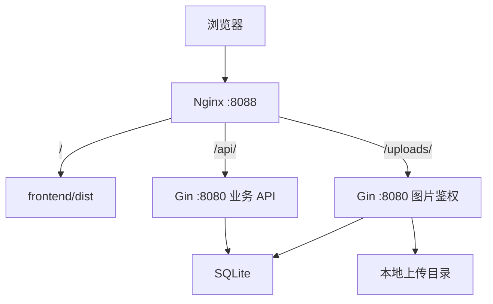

# 个人相册

| 学校 | 姓名 | 学号 |
| --- | --- | --- |
| 待填写 | 待填写 | 待填写 |

## 第 1 阶段

- [x] Go + Gin 后端和 Vue 3 + Vite 前端可独立启动
- [x] 首次启动创建 SQLite 数据库、三张表和上传目录
- [x] 后端提供健康检查，Vite 开发服务器通过同源代理调用
- [x] 前端可构建到 `frontend/dist/`

后端使用 Gin 和 ncruces/go-sqlite3。SQLite 驱动不依赖 C 编译器。Go 版本要求见 `backend/go.mod`，Node.js 版本要求见 `frontend/package.json`。

在 `backend/` 设置下表中的 JWT 密钥，再运行 `go run .`，默认监听 `127.0.0.1:8080`。启动后访问 `/api/v1/health`，预期 HTTP 200 和 `{"code":0,"message":"ok","data":{"status":"ok"}}`。SQLite 连接检查失败时返回 HTTP 503。

| 后端环境变量 | 默认值 |
| --- | --- |
| `PHOTO_ALBUM_JWT_SECRET` | 必填，至少 32 字节，重启时复用同一密钥 |
| `PHOTO_ALBUM_COOKIE_SECURE` | 本地 HTTP 留空，HTTPS 部署设为 `true` |
| `PHOTO_ALBUM_ADDR` | `127.0.0.1:8080` |
| `PHOTO_ALBUM_DB_PATH` | `data/photo-album.db` |
| `PHOTO_ALBUM_UPLOAD_DIR` | `uploads` |

相对路径以启动后端时的工作目录为准。从 `frontend/` 运行 `npm ci` 安装锁定的依赖，再运行 `npm run dev`。打开 `http://127.0.0.1:5173/` 进入公开广场。联通状态可通过 `http://127.0.0.1:5173/api/v1/health` 验证。仍在 `frontend/` 运行 `npm run build` 可生成生产构建。

## 第 2 阶段

- [x] 注册时上传头像，数据库保存 bcrypt 密码哈希
- [x] 登录签发 24 小时 JWT，受保护的 API 使用 Bearer 鉴权
- [x] 创建公开或私有相册，分页查看本人相册
- [x] 匿名公开广场分页返回创建者用户名和头像

| 方法及路径 | 请求与响应 |
| --- | --- |
| `POST /api/v1/register` | multipart 字段 `username`、`password`、`avatar`。密码为 8–72 字节。头像支持 JPEG、PNG、WebP，大小上限 5 MiB，像素上限 1600 万。成功返回 201 和用户信息 |
| `POST /api/v1/login` | JSON `username`、`password`。返回 `token` 和 `user`，并设置作用域为 `/uploads/` 的 HttpOnly Cookie |
| `POST /api/v1/logout` | 清除图片 Cookie。调用端自行丢弃 Bearer Token |
| `POST /api/v1/albums` | 需要 Bearer Token。JSON 示例 `{"name":"旅行","description":"照片记录","is_public":true}`，省略 `is_public` 时为私有 |
| `GET /api/v1/albums` | 需要 Bearer Token。分页返回本人相册 |
| `GET /api/v1/albums/public` | 匿名可用。每条记录的 `creator` 含 `id`、`username`、`avatar_url` |
| `GET /uploads/avatars/<filename>` | 匿名读取已注册的头像 |

JSON 响应用 `code`、`message`、`data` 包装。成功时 `code` 为 0，例如 `{"code":0,"message":"ok","data":{"items":[],"page":1,"page_size":12,"total":0}}`。错误时 `code` 为 HTTP 状态码。列表从第 1 页开始，默认每页 12 条，最大 100 条，按相册 ID 降序。越过最后一页时返回空列表。

[Windows PowerShell 双账号验收](docs/phase2-windows.md)

## 第 3 阶段

| 方法及路径 | 请求与响应 |
| --- | --- |
| `POST /api/v1/albums/:id/photos` | 相册主人用 Bearer Token 提交 multipart 字段 `photo`。成功返回 201，照片含 `id`、`album_id`、`file_path`、`file_size`（字节）和 `created_at` |
| `GET /api/v1/albums/:id/photos` | 可选 Bearer Token。响应含 `album` 摘要、`can_upload`、`items`、`page`、`page_size`、`total`。空相册也有摘要 |
| `GET /uploads/photos/<filename>` | 公开照片可匿名读取；私有照片用登录时设置的同源 Cookie 鉴权。图片响应禁止缓存 |

公开相册允许匿名读列表和图片。私有相册的列表和图片对匿名访问返回 401，对非主人返回 403。上传公开或私有相册均限本人。上传只接受经解码验证的 JPEG、PNG、WebP，单张上限 5 MiB 和 1600 万像素，同名文件分别保存。

[Windows PowerShell 照片和权限验收](docs/phase3-windows.md)

## 第 4 阶段

- [x] Vue 3 和 Vue Router 接入注册头像、登录、退出及登录状态恢复
- [x] 我的相册支持创建、可见性标识和分页
- [x] 公开广场支持匿名浏览、创建者头像和分页
- [x] 相册详情支持真实图片、分页、本人上传以及权限和失败提示

[Windows PowerShell 启动和浏览器验收](docs/phase4-windows.md)

## 第 5 阶段与课程验收

- [x] Nginx 统一托管 Vue 构建产物并反代 API 和图片
- [x] Windows 构建、启动、验证、重载、停止步骤
- [x] 相册主人可以在「我的相册」确认删除相册，处理关联照片
- [ ] 本机课程录屏与个人信息待提交人完成

技术栈为 Go、Gin、SQLite（ncruces/go-sqlite3）、Vue 3、Vue Router、Vite 和 Nginx。云端集成验收使用 Nginx 1.26.3。Windows 安装后以 `nginx.exe -v` 的输出记录自己的版本。

本地部署顺序为构建前端、启动 Gin、用 `deploy/nginx.conf` 启动 Nginx，然后从 `http://127.0.0.1:8088/` 验收。[Windows PowerShell 部署与课程验收步骤](deploy/README.md)



Nginx 用 `index.html` 处理 Vue 客户端路由，缺失的构建资源返回 404。`/api/` 和 `/uploads/` 保留原请求路径并转给 Gin。头像和公开照片允许匿名读取，私有照片列表用 Bearer JWT 校验，图片直链用同源 HttpOnly Cookie 校验。匿名访问私有资源返回 401，其他已登录用户返回 403。上传和删除都要求相册归属匹配。

`DELETE /api/v1/albums/:id` 通过 Bearer 鉴权。成功返回 200，例如 `{"code":0,"message":"ok","data":{"id":7,"cleanup_pending":false}}`。SQLite 在事务中删除相册和所属照片记录；提交后清理该相册独占的照片文件。磁盘清理失败时记日志并返回 `cleanup_pending: true`，对应图片已无法从接口读取。

## 开发中遇到的问题

- Windows 默认 PowerShell 的 Cookie 会话在验收中未转发 `/uploads/` 作用域的 Cookie。接口验收改为显式发送 Cookie，网页流程用 Chromium 验证浏览器会正常保存和清除 Cookie。
- Windows 临时上传目录丢失时，上传返回 500。保存前现在会创建缺失的目录。
- 开发代理转发超大 multipart 请求时，曾显示 500。Vite 开发入口提前返回 413，Nginx 入口有独立的请求体限制。

## 加分项

- `GET /api/v1/health` 可通过 Nginx 访问，返回连接到 SQLite 时的健康状态。
- 相册所有者可删除相册，删除前有确认提示。

### Docker Compose 一键启动（Windows）

打开 Docker Desktop，使用 Linux 容器。如果 Windows 手动部署的 Nginx 正占用 `8088`，先按 [部署文档](deploy/README.md) 停止那套 Nginx。在 PowerShell 中执行以下命令。项目解压路径不同时，替换第一行。

```powershell
Set-Location 'D:\photo_album-phase5\week05\homework\photo-album'
docker compose config -q
docker compose up --build -d --wait
docker compose ps
(Invoke-WebRequest -UseBasicParsing 'http://127.0.0.1:8088/').StatusCode
(Invoke-RestMethod 'http://127.0.0.1:8088/api/v1/health').data.status
Start-Process 'http://127.0.0.1:8088/'
```

首次启动会下载镜像和依赖，在镜像内执行前端构建并编译 Go。预期两个服务均显示 `healthy`，首页返回 `200`，健康接口输出 `ok`，浏览器打开公开广场。公开浏览、登录和图片访问均通过 Nginx 的 `8088` 入口。

在同一项目目录运行 `docker compose down` 停止。Compose 使用独立的具名卷 `album-data`，保存 SQLite、上传文件和首次启动生成的 JWT 密钥。普通 `down` 后重新启动仍使用该卷。

## 截图和视频

云端 Chromium 截图见 [验收截图](docs/screenshots/)。提交前按部署文档在自己的 Nginx 入口补拍 Network 同源截图，并核对带 ★ 的各项。截图应覆盖首页、注册头像、本人与广场的私有可见性、公开相册创建和上传、带创建者信息的广场、照片渲染、越权 403 和 Network 同源证据。

视频命名为 `姓名_学号_photo-album.mp4`，建议不超过 5 分钟，最长 6 分钟。开头用记事本展示学校、姓名、录制日期，并按课程通知的统一话术自我介绍。展示项目架构和启动过程，走通注册登录、创建相册、上传、广场、越权拒绝和 Network 验收，然后说明三类 Nginx 路径。视频单独上传，不提交到 Git。截止时间为布置作业后下次上课当天中午 12:00，以课程安排为准。[视频提交入口](https://f.kdocs.cn/g/picg2EGQ/)
